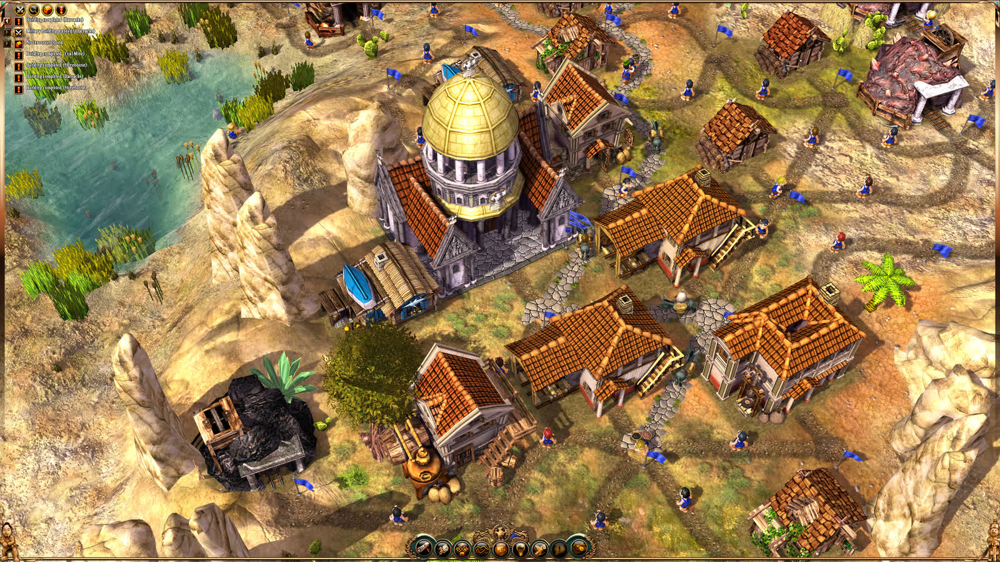
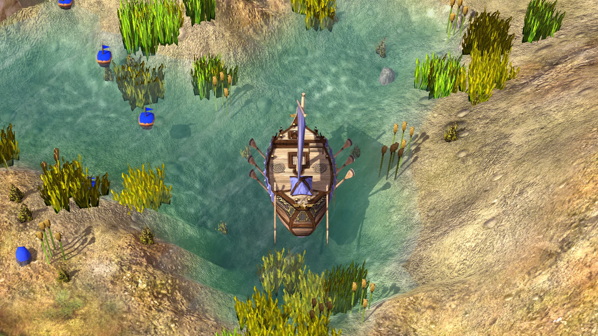
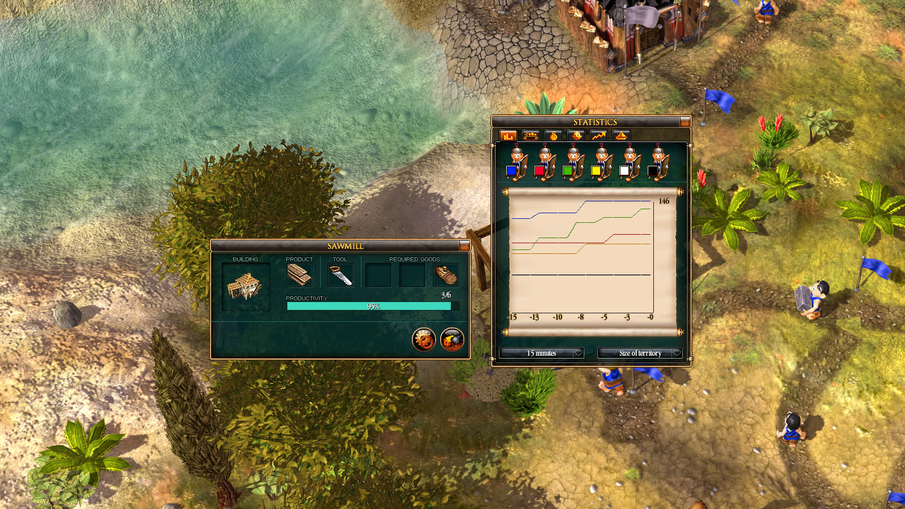
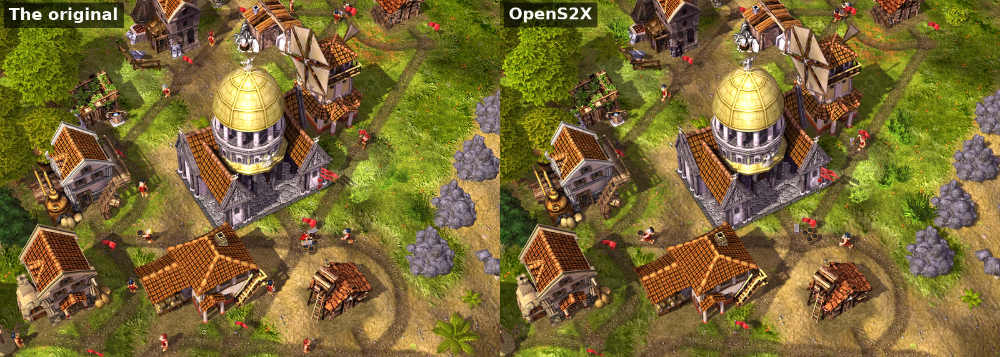
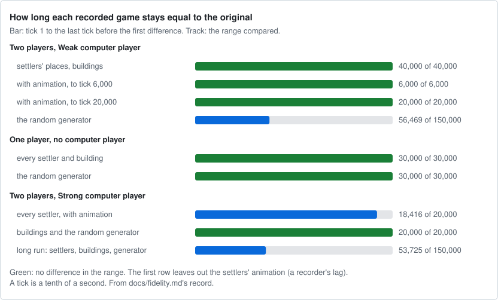
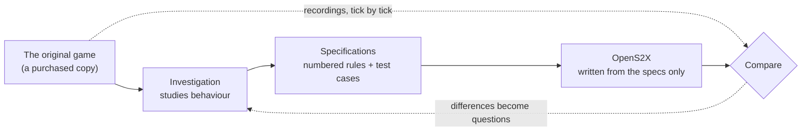
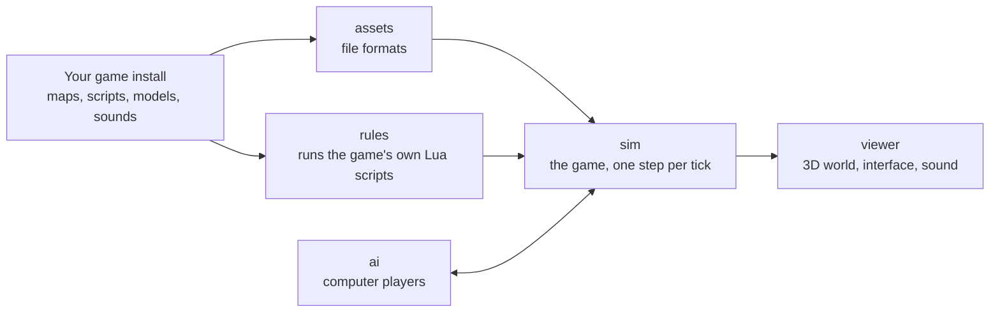

<h1 align="center">OpenS2X</h1>

<p align="center">
  <b>An open-source engine for <i>The Settlers II: 10th Anniversary</i>.<br>
  Written from scratch, measured tick for tick against the original.</b>
</p>

<p align="center">
  <a href="https://github.com/Jensenzo/OpenS2X/actions/workflows/ci.yml"></a>
  <a href="https://github.com/Jensenzo/OpenS2X/releases/latest"></a>
  <a href="LICENSE"></a>
</p>

<p align="center">
  
</p>

OpenS2X is a new program that runs the 2006 game *The Settlers II: 10th
Anniversary*. It reads the maps, scripts, models, textures, sounds and texts
from **your own installed copy** and plays the economy, the roads, the
battles and the computer opponents the way the original does. It is a
clean-room reimplementation: written in Rust from written specifications of
the game's behaviour, with no code of the original in it.

**It contains no game files.** You need the game (sold on [GOG](https://www.gog.com)).

> OpenS2X is not affiliated with, endorsed by or connected to Ubisoft, Blue
> Byte or Funatics. *The Settlers* is a trademark of Ubisoft Entertainment,
> used here only to say which game this engine runs. The screenshots show
> OpenS2X running with the maintainer's own copy of the game; the artwork in
> them belongs to its owners.

## Contents

- [Goals and scope](#goals-and-scope)
- [Status](#status)
- [Play it](#play-it)
- [How close it is to the original](#how-close-it-is-to-the-original)
- [How it works](#how-it-works)
- [Build from source](#build-from-source)
- [Modding](#modding)
- [Contributing](#contributing)
- [Questions](#questions)
- [Legal and licence](#legal-and-licence)

## Goals and scope

**Goals**

1. **The same game.** Same rules, same timing, same computer opponents. The
   simulation is compared with recordings of the original tick by tick, and
   the picture region by region.
2. **Measured, not claimed.** Every statement about closeness below comes
   from a measurement and says which release it was measured on.
3. **Keep it playable.** A twenty-year-old game on current Windows, with
   saves that keep loading in every later version.
4. **A base to build on.** Hooks for mods and new content, off by default, so
   the faithful game stays exactly the faithful game.

**Not goals**

- Shipping any of the game's content. There is none here and there never will be.
- Changing the rules, the balance or the art. That belongs in a mod built on the hooks.
- The 1996 original or its Gold Edition. [Return to the Roots](https://github.com/Return-To-The-Roots) does that.
- Multiplayer, for now.

## Status

**Version 0.15.1**. Free games, the campaign and
the tutorial are playable, through the original's menus. The last measured differences from the
original are being closed; see
[How close it is](#how-close-it-is-to-the-original).

| Area | State |
|---|---|
| Free game against computer players | Every map of your install, up to its player count; the three tribes, start resources, victory condition, fog of war |
| Campaign and tutorial | The ten missions and the four lessons, with their briefing, victory and defeat books, scripted events and the tutorial's window |
| Economy, roads, carriers, warehouses | Built from the specifications |
| Territory, soldiers, attacks, catapults | Built |
| Ships, harbours, expeditions | Built |
| Computer players | Weak, Normal and Strong; Weak and Strong measured against the original's |
| Saving and loading | Our own save format, loadable by every later version; the original's saves load and play on |
| 3D world and interface | The original's models, animations, shading and day light; its menus, settings pages, in-game bar and windows, each compared with a picture of the original |
| Sound and music | Effects, ambience, the tribes' music, battle music (Windows) |

Not there yet: multiplayer; saving in the original's file format; the
tutorial's "Info" pages and spoken end; the ending film.

<p align="center">
  
  
</p>

## Play it

**You need:** a legally owned, installed copy of *The Settlers II: 10th
Anniversary* (tested with the GOG edition, build 11757), and Windows 10 or 11
(64-bit) with a graphics card that runs Vulkan or DirectX 12.

1. Download `OpenS2X-<version>-windows-x64.zip` from [Releases](https://github.com/Jensenzo/OpenS2X/releases/latest) and unzip it anywhere.
2. Run `OpenS2X.exe`. It is not code-signed, so Windows SmartScreen asks once: "More info", then "Run anyway".
3. Point it at your game: the folder that contains `data` (GOG's default is `C:\GOG Games\Settlers 2 10th Anniversary`).

That is all. The game opens at the original's main menu.
[`PLAYING.md`](PLAYING.md) covers the menus, keys, saving and loading.

Good to know:

- **Your profile is shared with the original.** Settings and campaign
  progress live where the original keeps them (`Documents\S2\users`), so both
  programs see the same progress. OpenS2X keeps a `.bak` of the file the
  first time it changes it. Its own few settings (the game folder) are in
  `%APPDATA%\s2-reborn\settings.txt`; the folder keeps the project's earlier
  name.
- **Saves** go to `Documents\S2\saves` as `.s2save`. The original's `.sav` files load too.
- **The intro films are optional** and need a one-time conversion with FFmpeg: [`docs/video.md`](docs/video.md#converting-the-films-on-windows).
- **Nothing is sent anywhere.** No network code, no telemetry, no updater.
- Something wrong? [Open an issue](https://github.com/Jensenzo/OpenS2X/issues/new/choose). If it is a difference from the original, a screenshot of each helps most.

## How close it is to the original

<p align="center">
  
  <br><i>The computer player's town at game tick 9,500 (16 minutes in), from the same camera. Left: the original. Right: OpenS2X. Both halves cut and scaled alike; nothing else done to either.</i>
  <br><i>Why this scene: it is the recorded game the simulation is compared with, at a tick where the two games are still equal row for row (a row: one settler, one building or the random generator at one tick), and its player 0 gives no commands, so the town is the computer player's. What differs is the drawing, not the game: the right draws fewer of the settlers.</i>
</p>

**The simulation.** The original was recorded while playing
`MP_2P_Storm_Coast` (two players, start resources Medium): every settler's
position, every building and the state of its random generator, up to ten
times a second. OpenS2X plays the same set-up and the two are compared row by
row.

<p align="center"></p>

| Recorded game | Equal to the original |
|---|---|
| Two players, Weak computer player: every settler's place, every building | **every compared tick to 40,000** (67 minutes of game time) |
| The same game: the random generator | the first **63,126** ticks (105 minutes) |
| Two players, Strong computer player, long run | the first **58,114** ticks (96 minutes) |

The first row leaves out the settlers' animations, which that recording
logged a tick late (a lag of its recorder); the chart also shows the rows
with them. The random generator is the strictest
measure: it stays equal only while every part of the game has drawn from it
exactly as often as the original. After the first difference the two games
drift apart; closing those first differences is the remaining work. These
are version 0.15.1's numbers.

**The picture.** The same scenes are shot in both programs from the same
camera at the same tick: 12 pairs at 2560 x 1440, by day and at night. The
mean colour of each region (water by depth, the shore's film, sand, rock,
grass, dirt, paving, the headquarters' dome, a farm's ground) is compared.
In the latest run (measured on 0.10.1) **52 of 62 regions
are within 3 %** of the original in every colour channel. The other 10
miss 3 % only in a dark channel (below 30 of 255), and by at most one level
there. They are: at night the grass, paving, the dome, the shore's film and
shallow water (3 to 7 %); by day the blue of grass (4 % in the open, 11 % in
a farm's shade).

**What is known to differ.** Where a specification leaves a detail open, the
program does something reasonable meanwhile, a stand-in: marked in the code
with the word, and with the question that asks for the answer where there is
one ([`docs/stand-ins.md`](docs/stand-ins.md) lists them). The open
questions to the investigation (the side that studies the original, see
[How it works](#how-it-works)) are in
[`specs/OPEN_QUESTIONS.md`](specs/OPEN_QUESTIONS.md): 458 so far, 45 open and 49 partly answered. The full
record, with every recorded game: [`docs/fidelity.md`](docs/fidelity.md).

## How it works



**Clean room.** The work is split in two with a wall between. The
investigation studies the original and writes down what it does as
specifications ([`specs/`](specs/)): numbered rules in its own words, with
test cases. The code in this repository is written from those
specifications and nothing else. Where a rule is missing, the code asks a
question ([`specs/OPEN_QUESTIONS.md`](specs/OPEN_QUESTIONS.md)) instead of
guessing. No decompiled code, pseudocode or assembly is in this repository,
and no code from other reimplementations.



- **Deterministic.** Fixed ticks of a tenth of a second, as in the original.
  Where the original computes in 32-bit floats and the outcome depends on
  it, OpenS2X rounds the same way. The same map, seed and commands give the
  same game on Linux and Windows.
- **Tested.** About 1,980 tests written from the specifications' test
  cases, state hashes of whole games on Linux and Windows, 67 reference
  pictures, and a harness that plays the real program with the mouse and
  keyboard through the menus, the tutorial and the campaign.
- **Every rule is traceable.** Each rule has an id such as `ECO-DIST-1.6`;
  the code that implements it names the id, and so does the test that
  checks it.

| Crate | Role |
|---|---|
| `crates/sim` | The game: world state, commands, one step per tick. No I/O, no rendering, no wall-clock time. |
| `crates/rules` | Runs the original's Lua property scripts (from your install) into the rule set the simulation uses. |
| `crates/assets` | Readers for the original's file formats: containers, maps, models, textures, saves. |
| `crates/ai` | The computer player: reads the world, gives the same commands a human player gives. |
| `crates/app` | The command-line tool: inspect files, run games headless, trace, compare. |
| `crates/viewer` | The game (`OpenS2X`) and the developer's viewer (`s2-viewer`), on [Bevy](https://bevyengine.org). |

More: [`docs/index.md`](docs/index.md) lists every document.

## Build from source

Linux or WSL2 on Windows is the development platform; the game runs on
Windows (on Linux without sound).

- [rustup](https://rustup.rs). The toolchain (with rustfmt, Clippy and the Windows target) is pinned in `rust-toolchain.toml` and installed by the first `cargo` command.
- For Bevy on Linux: `sudo apt install libasound2-dev libudev-dev libwayland-dev libxkbcommon-dev`.
- For the Windows executable from Linux or WSL: `sudo apt install mingw-w64`.

```bash
git clone https://github.com/Jensenzo/OpenS2X && cd OpenS2X
export S2_GAME_DIR=/path/to/your/game          # the folder that contains data/

cargo test --workspace                         # tests needing the game skip without S2_GAME_DIR
cargo build --profile dist --target x86_64-pc-windows-gnu -p s2-viewer --bin OpenS2X
target/x86_64-pc-windows-gnu/dist/OpenS2X.exe --game-dir "$(wslpath -w "$S2_GAME_DIR")"   # from WSL
cargo run --release -p s2-viewer --bin OpenS2X -- --game-dir "$S2_GAME_DIR"   # Linux, no sound
```

On Windows with the MSVC toolchain: `cargo build --profile dist -p s2-viewer
--bin OpenS2X`. The safety net that runs before each release is in
[`docs/test-coverage.md`](docs/test-coverage.md) and
[`docs/releasing.md`](docs/releasing.md).

## Modding

OpenS2X plays the rules as shipped. Changes to rules or content (a tuned
cost, a new building, new art, your own music) belong in a separate project
built on these crates. The hooks for that (rules overlays, asset folders,
render options, Bevy plugins, the simulation's public API) are documented in
[`docs/extending.md`](docs/extending.md) and [`docs/api.md`](docs/api.md);
with none of them used, the game is exactly the original's.

## Contributing

Bug reports and "this differs from the original" reports are the most useful
contribution: see [`CONTRIBUTING.md`](CONTRIBUTING.md). Two things to know
first:

- **The clean-room rule applies to everyone.** No decompiled code, no game
  files, no code from GPL-licensed reimplementations, in issues or patches.
- **This repository is a release mirror.** Development happens in the
  maintainer's working repository and each release lands here as one commit,
  so pull requests cannot be merged directly. Accepted patches are applied
  there with credit and appear in the next release.

## Questions

**Why do I need the original game?** OpenS2X is only the engine. Every
picture, sound, map and rule comes from your copy at run time.

**Which editions work?** The GOG edition (build 11757) is the one tested.
Others may work.

**How is this different from Return to the Roots or Widelands?** Return to
the Roots reimplements the 1996 game (Gold Edition). Widelands is its own
game, inspired by it. OpenS2X runs the 2006 3D remake, and aims to match it
exactly.

**Linux or macOS?** It builds and runs on Linux, without sound. macOS is not
tested. The download is for Windows.

**Is it finished?** Not yet. It is playable: free games, the campaign and
the tutorial. What remains is closing the last measured differences from the
original, and the parts listed under [Status](#status).

## Legal and licence

OpenS2X contains code and specifications written for this project. It
contains no files from the original game; you need your own, legally
obtained copy, which the program reads at run time. The analysis behind the
specifications was done on a purchased copy, to make an independently
written program work with the game's own files.

If you hold rights in the original game and have a concern about this
project, please [open an issue](https://github.com/Jensenzo/OpenS2X/issues/new).
I would rather hear about it directly.

Code and specifications: Apache License 2.0 ([`LICENSE`](LICENSE)). The
Windows download carries the notices of the third-party libraries it is
built with (`THIRD-PARTY-LICENSES.txt`).

Built with Rust, [Bevy](https://bevyengine.org) and
[mlua](https://github.com/mlua-rs/mlua). Thank you to the people who made the
original game. Twenty years on, it is still worth all this.
